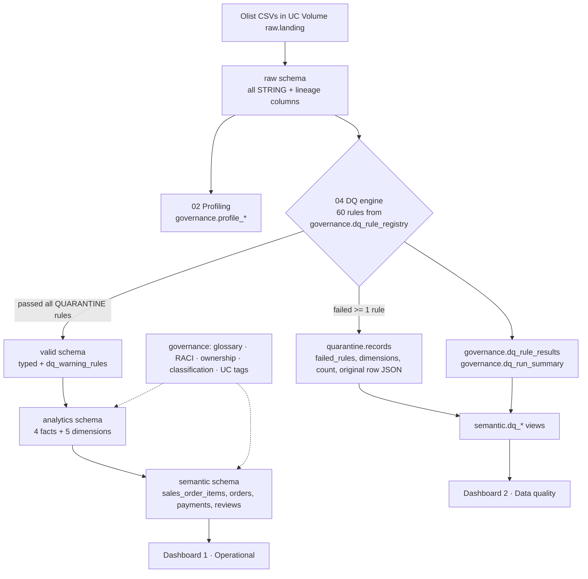
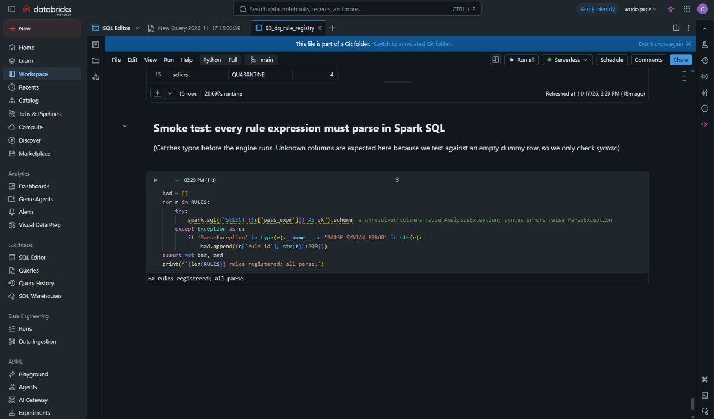
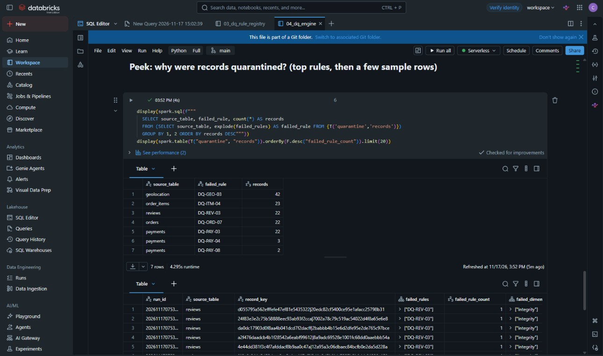
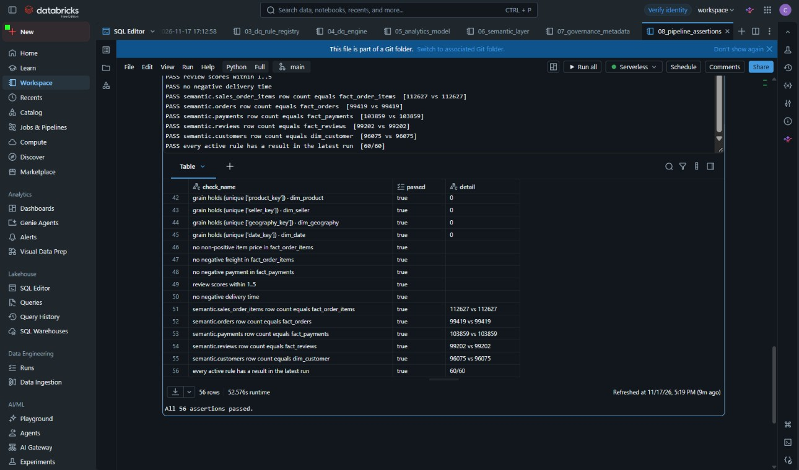
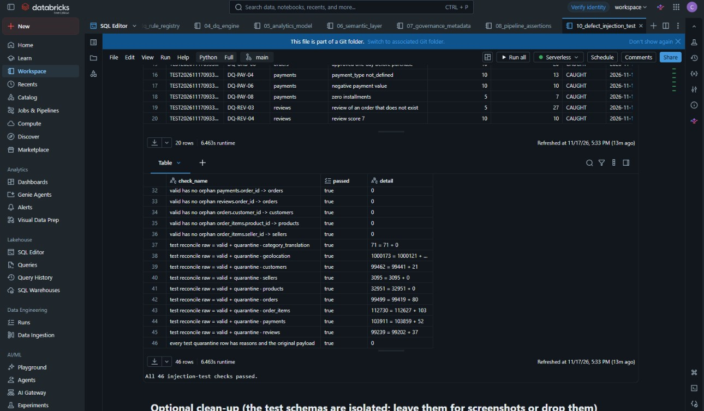
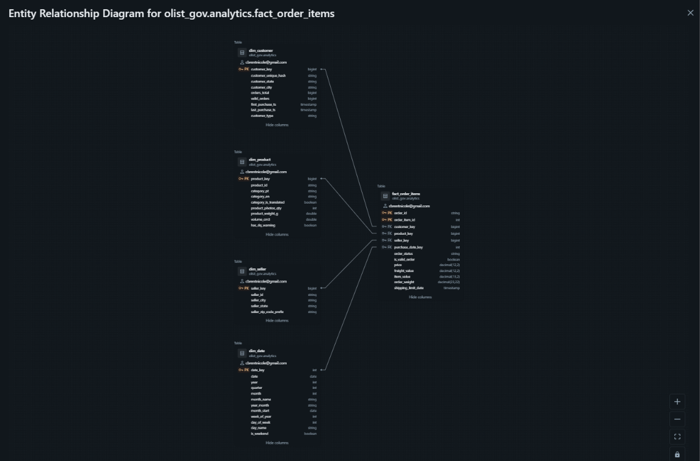
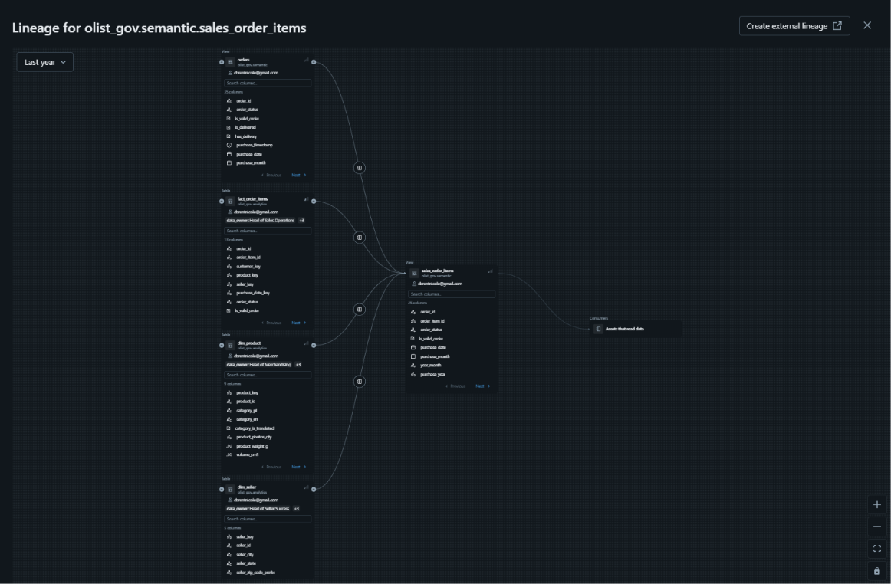
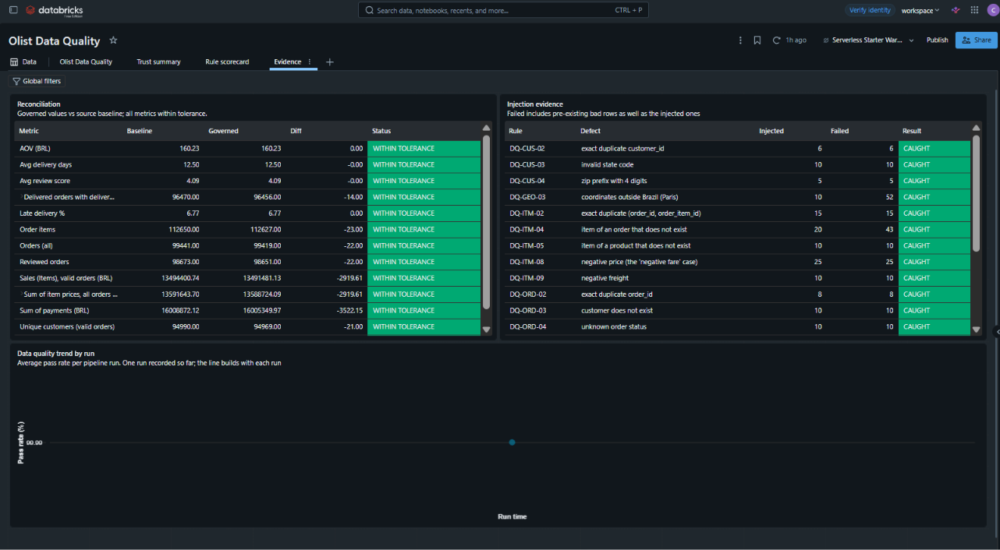

# Olist governed analytics on Databricks

End-to-end, rule-driven data quality pipeline for the Olist Brazilian E-Commerce dataset (Case Study 06 - Data Governance Essentials).

> **Principle:** raw data does not automatically become trusted analytical data. Data is validated, failures are observable and retained, and only trusted records reach business-facing products.

## 1. Architecture

Text version for the submission: `Source → Raw → Data Quality → {Valid, Quarantine} → Facts + Dimensions → Semantic Layer → Operational Dashboard`, with `Quarantine + results → Data Quality Dashboard`.

## Results (Databricks run)

- 1,550,922 records evaluated, 1,550,786 valid, 136 quarantined (pass rate 99.991%).
- 60 rules: 59 passed, 1 warning (DQ-REV-07, 1,098 reviews on orders with more than one review), 0 failed.
- Governed KPIs are 0.02% below the earlier ungoverned dashboard, exactly the quarantined items (R$ 2,919.61).
- 56/56 pipeline assertions passed; 46/46 defect-injection checks passed (209 injected defects, all caught).

### Data quality dashboard

## 2. Repository map

| Path | What it is |
|---|---|
| `notebooks/00_setup.py` | catalog/schemas/volume, constants (typed staging contract, business keys, processing order) |
| `notebooks/01_ingest_raw.py` | CSV → `raw.*` (all string), schema-contract check, ingestion log |
| `notebooks/02_profile_sources.py` | profiling: counts, nulls, duplicates, ranges, categoricals, orphans, unusual values, payment/item reconciliation |
| `notebooks/03_dq_rule_registry.py` | the 60 rules as a table (generated) + syntax smoke test |
| `notebooks/04_dq_engine.py` | evaluates rules, writes `valid.*`, `quarantine.records`, results |
| `notebooks/05_analytics_model.py` | dimensions, facts, informational PK/FK |
| `notebooks/06_semantic_layer.py` | operational + DQ views |
| `notebooks/07_governance_metadata.py` | ownership, RACI, glossary, classification, UC tags/comments, access templates, lineage |
| `notebooks/08_pipeline_assertions.py` | reconciliation and valid-only proofs (fails the run if broken) |
| `notebooks/09_run_all.py` | orchestrator |
| `notebooks/10_defect_injection_test.py` | **test**: injects 209 deliberately broken rows into an isolated `_test` copy and proves each rule catches them |
| `sql/dashboard_queries.sql` | every dashboard dataset, annotated with the widget to build |
| `docs/DQ_RULES.md` | rule documentation (Rule ID, dimension, table/field, rule, rationale, failure action) |
| `docs/DATA_MODEL.md` | ER diagram + grain of each fact |
| `docs/PROFILING_FINDINGS.md` | template tying each profiling finding to a rule (you fill in your counts) |
| `tools/local_dry_run.py` | runs all rules on the CSVs locally (pandas + SQLite, no Databricks) and writes `docs/LOCAL_DRY_RUN.md`; `pip install -r tools/requirements.txt` |
| `docs/LOCAL_DRY_RUN.md` | output of that run on the real data |
| `tools/build_rules.py` | single source of truth for the rules: regenerates notebook 03 and `docs/DQ_RULES.md` (`python tools/build_rules.py`) |
| `data/README.md` | where to get the Olist CSVs (not committed) |

## 3. How to run (Databricks)

> Editing a rule? Change it in `tools/build_rules.py`, run `python tools/build_rules.py`, then re-import notebook 03. That keeps the registry and `docs/DQ_RULES.md` in sync.

1. Import the `notebooks/` folder into your workspace (Workspace → Import → the files are in Databricks source format) or sync the repo with a Git folder.
2. Run `00_setup` once (it tries to create catalog `olist_gov`; if your workspace refuses, it falls back to your current catalog).
3. Upload the 9 Olist CSVs to **Catalog → `<catalog>` → `raw` → `landing`** (volume), keeping the original file names.
4. Run `09_run_all` (or run 01 → 08 manually; `02_profile_sources` is on-demand and is where you collect evidence for your rules).
5. Build the two dashboards from `sql/dashboard_queries.sql` (section 6).
6. Optional: create a **Job** with tasks 01 → 03 → 04 → 05 → 06 → 07 → 08 (each depends on the previous) and schedule it. Compute: serverless works; the code avoids `cache()`/`persist()`.

For a real deployment keep the hashing salt in a secret scope (`olist_hash_salt`) and pass `hash_salt_scope`; otherwise a DEV salt is used and a warning is printed.

## 4. Data quality approach

* **Rules are data.** `governance.dq_rule_registry` holds each rule's id, dimension, table/field, Spark-SQL pass-condition, rationale, failure action, target pass-rate, domain, owner, steward. Changing a rule never means editing pipeline code.
* **60 rules, six dimensions** (Completeness 12, Uniqueness 9, Validity 14, Integrity 9, Reasonability 8, Consistency 8). Full table in [`docs/DQ_RULES.md`](docs/DQ_RULES.md).
* **Two failure actions.** `QUARANTINE` (47 rules): record leaves the valid layer. `FLAG` (13 rules): the defect does not invalidate the business fact, so the record continues with `dq_warning_rules` set and counts as a *warning* on the scorecard.
* **Status-aware rules.** Many rules depend on order status (e.g. only *delivered* orders need a delivery date; canceled orders may have no items), which avoids false alarms.
* **Cascading integrity.** Child tables check the *valid* parent: a rejected order rejects its items, payments and reviews, so facts never contain orphans.
* **No silent correction.** Only trimming, empty→NULL and `try_cast` are applied; every cast failure is caught by a rule. Duplicates: the first occurrence is kept, extra copies are quarantined.
* **Negative-value lesson from the demo (NYC taxi: nobody pays a negative fare).** Olist equivalents: `DQ-ITM-08` (price > 0), `DQ-ITM-09` (freight ≥ 0), `DQ-PAY-06` (payment ≥ 0), `DQ-ORD-08/09` (no time travel in the order lifecycle).
* **Not implemented, on purpose:** *Timeliness* (static historical snapshot, no freshness SLA) and *Accuracy* (no independent ground truth). Documented as limitations.

### How quarantined records are handled
`quarantine.records` holds one row per failed record: `run_id`, `source_table`, `record_key`, `failed_rules` (array), `failed_rule_count`, `failed_dimensions`, `warning_rules`, `record_payload` (the original row as JSON), `source_file`, `source_row_id`, `quarantined_at`.
Stewards investigate through `semantic.dq_quarantine_detail` (one row per record × rule). Fixing happens **at the source or by a steward-approved rule change**, then the pipeline is re-run; records are never edited in place and never deleted.

## 5. Model, semantic layer, key metrics

* **Grains:** `fact_orders` = order · `fact_order_items` = order item (with `order_weight`) · `fact_payments` = payment · `fact_reviews` = review on an order (`is_latest_review` marks the one used for scores) · `dim_customer` = **person** (`customer_unique_id`, salted hash). See [`docs/DATA_MODEL.md`](docs/DATA_MODEL.md).
* **Semantic views:** `orders`, `sales_order_items`, `customers`, `payments`, `reviews` (business names, no surrogate keys, no free-text comments, pseudonymised customer) and the `dq_*` views.
* **Same definitions as the earlier Case Study 4 dashboard**, so the governed dashboard and the old one can be compared like for like:

| Metric | Definition (unchanged from the Power BI project) |
|---|---|
| Valid order | status not `canceled` / `unavailable` (`is_valid_order`). *Business term; not the same as a "valid record", which means "passed data-quality rules".* |
| Sales (Items) | sum of item price on valid orders, freight excluded |
| Order value / AOV | price + freight; AOV = order value ÷ valid orders |
| Unique customers / repeat | distinct `customer_unique_id` with a valid order; repeat = 2+ valid orders |
| Delivery metrics | only `delivered` orders that have a delivered date, compared by **calendar date** |
| Late delivery % | delivered after the estimated date ÷ delivered orders |
| Review score | latest review per order |
| Item-grain averages | weighted by `order_weight = 1 / items in order`; never sum order values from the item table |

## 6. Dashboards (Databricks AI/BI)

Create both from the datasets in `sql/dashboard_queries.sql` (Dashboards → Create dashboard → Data tab → paste each query). Databricks cannot import a `.pbix`, so each Power BI measure was translated to SQL.

**Dashboard 1 - Operational: the same four pages as your Power BI version**

| Page | Datasets (in `sql/dashboard_queries.sql`) | Power BI visual it replaces |
|---|---|---|
| 1 Executive overview | `p1_kpis`, `p1_monthly`, `p1_status` | 6 KPI cards, monthly sales line + orders columns, status bar |
| 2 Customers | `p2_kpis`, `p2_states`, `p2_repeat_vs_onetime` | KPI cards, state map/bar, repeat vs one-time |
| 3 Products and sellers | `p3_top_categories`, `p3_aov_by_category`, `p3_seller_pareto`, `p3_top_sellers` | category bars, Pareto, top-seller table |
| 4 Delivery and experience | `p4_kpis`, `p4_late_by_month`, `p4_late_by_state`, `p4_review_by_delay`, `p4_review_distribution`, `p4_lowest_rated_categories`, `p4_insight_late_vs_ontime` | delivery/review visuals and the dynamic insight box |

Each page also carries the `ds_trust_banner` counter (verdict from the DQ dashboard). Keep your earlier design rules: colour-blind-safe palette (`#0072B2` main, `#D55E00` problems, `#E69F00` highlight, `#BDBDBD` de-emphasis), bars from zero, trends on complete months only (2017-01 to 2018-08), same filters (year, month, state) on every page.

**Dashboard 2 - Data quality (page layout)**
1. *Trust:* verdict (`TRUSTED` / `USE WITH CAUTION` / `NOT TRUSTED`), records evaluated / valid / quarantined, pass rate, failure rate, item-value coverage, rules passed / warning / failed
2. *Reconciliation:* `dq_reconciliation`, governed KPIs vs the figures your earlier dashboard published (status `REVIEW` when the gap is above 0.5 %)
3. *Where it fails:* failures by table, by dimension, top failing rules, scorecard with PASSED/WARNING/FAILED colouring
4. *Impact and ownership:* BRL value of quarantined items by rule, workload per steward
5. *Investigate, trend, evidence:* quarantine drill-down (filter by table/rule), pass-rate trend, and `dq_injection_evidence` (proof from notebook 10)

Verdict logic: `TRUSTED` = no hard rule below target **and** at least 99 % of raw item value reached the analytics layer; `USE WITH CAUTION` = at least 95 %; otherwise `NOT TRUSTED`. Thresholds are steward-owned assumptions.

Optional upgrade: a **Genie space** on the `semantic` schema lets business users ask questions in plain English against the governed layer.

## 6b. Results on your real data (local dry-run) and why notebook 10 exists
`tools/local_dry_run.py` re-implements the engine with pandas + SQLite and ran all 60 rules on your 9 CSVs (full output in [`docs/LOCAL_DRY_RUN.md`](docs/LOCAL_DRY_RUN.md)). It is a rehearsal, not Spark: the Databricks run should give the same counts, and a difference would be a bug to investigate.

**Headline:** 1,550,922 records evaluated, **136 quarantined (pass rate 99.991 %)**, no hard rule below target, one WARNING. Verdict: the data behind the dashboard is trustworthy.

| Quarantined | Records | Why |
|---|---|---|
| `geolocation` | 42 | coordinates outside Brazil (21 zip prefixes with points in Europe/Argentina but a Brazilian state label) - `DQ-GEO-03` |
| `orders` | 22 | delivered orders with no delivered date (8) or no approval date (14) - `DQ-ORD-07` |
| `order_items` / `payments` / `reviews` | 23 / 22 / 22 | children of those 22 orders (cascade) - `DQ-ITM-04`, `DQ-PAY-03`, `DQ-REV-03` |
| `payments` | 5 | `payment_type = not_defined` (3), zero installments (2) - `DQ-PAY-04`, `DQ-PAY-08` |

Value at risk: R$ 2,919.61 of item price = **0.0215 %** of the total.

Kept but flagged (counted as warnings): 1,098 reviews on orders with more than one review (`DQ-REV-07`, 98.89 % vs a 99 % target → the single **WARNING**), 610 products without a category and 13 with an untranslated one, 279 customers whose zip is missing in geolocation, 222 orders whose payments differ from items + freight beyond tolerance, 189 orders with carrier/delivery dates out of sequence, 9 zero-value payments, 6 non-delivered orders with a delivered date, 6 products with zero weight or dimensions. These match what your earlier profiling found (610, 9, 6, …), which is a useful cross-check.

**Reconciliation with the earlier dashboard.** Recomputing your KPIs from the *raw* data with the definitions used here reproduces your published numbers exactly (99,441 orders, 112,650 items, R$ 13,591,643.70, 98,207 valid orders, 94,990 customers, R$ 13,494,400.74 sales, 96,470 delivered; AOV, late %, delivery days and review score match after rounding). That confirms the model definitions are aligned. The governed (valid-only) numbers are about **0.02 % lower**, which is exactly the quarantined orders; every KPI stays inside the 0.5 % tolerance of `dq_kpi_reconciliation`.

**Why a defect-injection test.** Real Olist is nearly clean, and a quarantine of 136 records cannot show that the controls would catch bad data (for example, no negative price exists in the real file, so `DQ-ITM-08` never fires). Notebook `10_defect_injection_test.py` injects 209 known defects into an isolated `_test` copy, shows each is caught by the intended rule, and stores the evidence in `governance.dq_injection_test_results` (shown on the DQ dashboard). The same style of injection was rehearsed locally and every targeted rule fired with the expected counts (for example 25 negative prices, 20 orphan items, 15 duplicate items, 10 future-dated orders).

## 7. Alignment with the Module 06 lecture

| Lecture topic | Where it lives |
|---|---|
| Why numbers don't match (definition, source, quality, ownership, accountability) | glossary with one definition per metric; one semantic layer feeding every dashboard |
| Governance = people + process + policy + technology | roles in `data_ownership`/`raci`; rules as policy; Unity Catalog as technology |
| Data domains | Customer, Seller, Product, Sales, Finance, Customer Experience, Reference Data |
| Owner / Steward / Custodian / Consumer and RACI | `governance.data_ownership`, `governance.raci`, owner & steward columns in the rule registry and scorecard |
| Business metadata: glossary, data dictionary, catalog, lineage | `business_glossary`; UC comments and tags; Catalog Explorer lineage (screenshot it) |
| DQ dimensions (accuracy, completeness, consistency, integrity, reasonability, timeliness, uniqueness, validity) | 6 implemented; 2 justified exclusions |
| DQ control cycle: define → measure → monitor → detect → resolve → improve | registry → engine → dashboard → scorecard statuses → quarantine investigation → rule versioning (`rule_version`) |
| DQ scorecard with thresholds | `dq_rule_scorecard` (target pass rate, PASSED / WARNING / FAILED) |
| Master/reference data | geolocation and category translation treated as reference data with their own rules; entity resolution noted as a limitation (see below) |
| Classification, privacy, access | `column_classification` (RA 10173 PI/SPI + Public/Internal/Confidential/Restricted), salted hash of `customer_unique_id`, comments excluded from semantic layer, grant/mask templates, quarantine restricted to stewards |

## 8. Important assumptions (to confirm with the Data Owner)
* Thresholds: price ≤ 10,000 BRL, freight ≤ 1,000 BRL, installments ≤ 24, purchases not before 2016-01-01, payment reconciliation tolerance max(1 BRL, 5 %), Brazil bounding box for coordinates.
* `(review_id, order_id)` is the review business key; the same `review_id` on different orders is legitimate.
* Orders with no items are acceptable when canceled/unavailable, a defect when delivered.
* Geolocation has multiple rows per zip by design; it is aggregated, not de-duplicated.
* Target pass rates per rule are initial proposals.

## 9. Known limitations
* The pipeline is full-refresh batch. Quarantine keeps only the **latest** run; rule results and run summaries keep full history.
* Partially quarantined orders stay valid and are marked `is_complete_order = false` (see data model doc) rather than being cascaded upward.
* No entity resolution: `customer_unique_id` is trusted as the person key.
* No Timeliness or Accuracy checks (see above).
* The tolerance-based payment reconciliation cannot distinguish installment interest from genuine errors.
* AI/BI dashboards are built in the UI; this repo supplies every dataset query and the layout, not the dashboard JSON.
* The rule logic and KPI definitions were rehearsed on your real CSVs with `tools/local_dry_run.py` (pandas + SQLite), but the Spark notebooks themselves have not yet been run in a live workspace. Run 01 → 08 and 10, and compare the counts with `docs/LOCAL_DRY_RUN.md`; any difference is a bug to chase.

## 10. Submission checklist
- [ ] Notebooks run end to end, `08_pipeline_assertions` passes (screenshot)
- [ ] Profiling output, with a short findings note per rule family (template below)
- [ ] `docs/DQ_RULES.md`
- [ ] ER diagram (`docs/DATA_MODEL.md` rendered, or screenshot from Catalog Explorer)
- [ ] Architecture diagram (section 1)
- [ ] Lineage screenshot (Catalog Explorer)
- [ ] Both dashboards published + screenshots
- [ ] This README, with your actual counts filled into a short "Results" paragraph

**Profiling findings template**

| Finding (from notebook 02) | Evidence (count / %) | Rule created | Decision (quarantine / flag / accept) |
|---|---|---|---|
| e.g. delivered orders with no delivery date | n = … | DQ-ORD-07 | quarantine |
